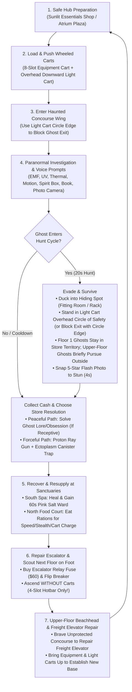

# Megamall Anomaly — Game Design Bible & Master Workbook

> **Working Title:** *Megamall Anomaly*  
> **Genre:** Co-op / Solo Liminal Paranormal Investigation, Survival Economy & Vertical Escape  
> **Target Engine & Architecture:** **Godot 4 (Forward+ Vulkan Renderer)** on Arch Linux / Cross-Platform Co-op (`MultiplayerAPI` / Physically-Based Raycast & NavMesh VoIP / Local Vosk & Whisper Speech Recognition), backed by verified mechanics in [`UnrealSourceReference/MyProject2/`](../UnrealSourceReference/MyProject2)  
> **Document Purpose:** Central source of truth connecting the **Core Gameplay Loop**, **Story & Hidden Lore**, **Map/Floor Architecture**, **Reference Systems**, and the **Master Production Backlog**.

---

## 1. Executive Vision & Design Pillars

### Elevator Pitch
Hired as freelance paranormal investigators to track down a missing person last seen entering a shuttered suburban shopping center, your team steps through the service doors—only for the entrance to vanish behind you. You are trapped inside an impossible, pocket-dimension **Megamall** where hallways subtly bend on their own, automated airlocks drop rations from nowhere, and the retail stores are haunted by restless entities. To reach the upper levels and uncover the truth behind the person you were sent to find, you must **investigate haunted stores for cash**, **barter with trapped survivor merchants**, **push heavy equipment and floodlight carts through dark concourses**, **recover in geothermal bathhouses and night-market food courts**, and **repair escalators and freight elevators to ascend floor by floor**.

### Core Design Pillars
1. **Tactile Cart & Tool Logistics:** You only have a **4-slot hotbar** (`BP_InventoryComponent`). Venturing into a haunted wing requires loading an 8-slot **Equipment Push Cart** ([`AMallPushCart`](../UnrealSourceReference/MyProject2/Equipment/MallPushCart.h)) and towing a battery-powered **Mobile Light Cart** ([`AMallLightCart`](../UnrealSourceReference/MyProject2/Equipment/MallLightCart.h)). How you position your carts physically changes the rules of every encounter—and ascending a stepped escalator to a new floor forces a perilous **cart-less scouting phase** until you locate and repair that floor's **Service Freight Elevator**.
2. **Investigation & Choice-Driven Store Resolution:** Evidence isn't just for a scorecard—every EMF-5 reading, UV footprint, ghost-written ledger, spirit-box EVP, and 5-star ghost photograph converts into **hard currency (`$`)**. Furthermore, clearing a haunted store offers **two tactical paths**: players can uncover a ghost's identity and unresolved routine to attempt a **Peaceful Lore Resolution** (saving combat resources), *or* use the **Parody Proton Ray Gun & Ectoplasm Canister** for a **Forceful Extraction**—knowing that some hostile entities will *refuse* peace and force a fight.
3. **Cozy Sanctuaries vs. Liminal Dread:** The mall contrasts warm, inviting survivor sanctuaries—like the **South Tangquan Bathhouse & Pink Salt Spa** ([`AMallSpaHealingZone`](../UnrealSourceReference/MyProject2/Environment/MallSpaAndFoodSystem.h)), **North Night-Market Food Court** ([`AMallFoodRationItem`](../UnrealSourceReference/MyProject2/Environment/MallSpaAndFoodSystem.h)), and **Quartermaster Chen's Sunlit Surplus Hub** ([`AMallStoreVendorNPC`](../UnrealSourceReference/MyProject2/Environment/MallStoreVendorNPC.h))—against unnerving, drifting hallways ([`AMallSplineCorridor`](../UnrealSourceReference/MyProject2/Environment/MallSplineCorridor.h)) and pitch-black haunted boutiques.
4. **Physically-Based Acoustics, VoIP & Dynamic Lighting:** Co-op voice chat (`AudioStreamMicrophone` -> `AudioStreamPlayer3D`) is physically simulated in the 3D environment: multi-directional raycasts measure local room volume (tight fitting rooms vs. concourse hallways vs. the massive Oval Atrium) to drive dynamic reverb, wall/shutter raycasts apply low-pass muffling, and `NavigationServer3D` pathing bends voices out open store entrances. Ceiling and storefront lights can be toggled, dimmed (`100%` / `45%` / `OFF`), and flickered dynamically by both players and ghosts.
5. **Layered Environmental Mystery:** Players can play purely for the co-op ghost-hunting and escape loop, *or* dig into a deep web of **hidden lore**—tuning the Spirit Box to secret frequencies, photographing anomaly decals, reading ghost ledgers, and piecing together what happened to the missing target and why the Mall's upper canopy looks like a vaulted spaceship hull.

---

## 2. Core Gameplay Loop & Progression Framework



### Phase-by-Phase Breakdown

#### Phase 1: Safe Hub & Loadout Preparation
- Players spawn or regroup in the **Central Oval Atrium** ([`AMallCurvedAtriumRing`](../UnrealSourceReference/MyProject2/Environment/MallCurvedAtriumRing.h)) and visit **Quartermaster Chen** at **Flash & Phantom Surplus** ([`AMallStoreVendorNPC`](../UnrealSourceReference/MyProject2/Environment/MallStoreVendorNPC.h)).
- Players select tools into their **4-slot hotbar** (`1–4`) plus their dedicated belt **Flashlight** (`T`, [`AMallCartFlashlight`](../UnrealSourceReference/MyProject2/Equipment/MallCartFlashlight.h)) and load extra tools onto the **8-slot Equipment Push Cart** ([`AMallPushCart`](../UnrealSourceReference/MyProject2/Equipment/MallPushCart.h)).
- **The "Hands" as an Extra Pseudo-5th Slot (`Hands-Only` & Overflow Carry):**
  - In addition to the **4-slot hotbar (`1–4`)**, the player's **Hands** act as a **pseudo-5th slot**.
  - Certain bulky or special items—such as a fallen investigator's **Death Inventory Crate**, the **Two-Handed Heavy Hydraulic Assembly**, **Escalator Relay Fuse Crates**, or an **Assembled Video Camera + Camera Stand (Tripod) Rig**—**can only be carried in hand and never on the hotbar** (though unattached Video Cameras and folded Camera Stands each fit into a standard hotbar slot, and either unattached pieces or the assembled rig can hang on the exterior hooks of an Equipment Push Cart). Standard tools picked up when all 4 hotbar slots are already full are also held in the Hands slot.
  - **Switching Hotbar Slots Drops Unslotted Hand Items:** If a player is carrying an item in their Hands (either a `Hands-Only` item or a 5th overflow tool with no open hotbar slot) and switches to an item on their **4-slot hotbar (`1–4`)**, the hand-carried item is **automatically dropped onto the floor** at their feet.
- Before heading out, players verify the **Light Cart** ([`AMallLightCart`](../UnrealSourceReference/MyProject2/Equipment/MallLightCart.h)) is charged at a **Wall Charger** ([`AMallCartCharger`](../UnrealSourceReference/MyProject2/Equipment/MallCartCharger.h)) (`15 min` full runtime, `5 min` recharge).

#### Phase 2: Wheeled Cart Logistics, Pusher-Screen, Overhead Light Circle of Safety & Store Territory Rules
When approaching a haunted store ([`AMallRetailStoreUnit`](../UnrealSourceReference/MyProject2/Environment/MallRetailStoreUnit.h)), how the team positions the **Equipment Push Cart** and the **Wheeled Mobile Light Cart** dictates area control and ghost containment:
- **Wheeled Mobile Light Cart & Overhead Circle of Safety (`SAFETY_CIRCLE_RADIUS = 3.25m`):**
  - The **Mobile Light Cart** rolls on **4 caster wheels** and features a tall overhead mast with a high-output floodlight head that **points straight down (`-Y`)**, projecting a bright **Circle of Safety** on the floor beneath it.
  - **Refuge & Perimeter Blocking:** Ghosts **cannot enter** the illuminated Circle of Safety while the battery lasts. Crucially, **the edge of the Circle of Safety acts as a physical barrier that blocks ghosts from leaving or entering areas**—parking the wheeled Light Cart so the perimeter of its downward light circle spans a store entrance or aisle choke point prevents the ghost from crossing that boundary.
- **Pusher-Side Computer Monitor (`UMallCartMonitorComponent` — Open Top Shelf & Comedic View Obstruction):**
  - Every **Equipment Push Cart** features a bulky CRT/LCD **Computer Monitor** mounted right at the front of the rear push-handle where players stand to push the cart.
  - This leaves the **rest of the top shelf completely open** for equipment, while creating a hilarious physical quirk: when you grab the handle to push the cart around, the monitor sits right in front of your face and blocks a large chunk of your forward view—forcing you to peek around it, rely on teammates to call out obstacles, or hang a switched-on **Video Camera** on the front of the cart to steer via the screen like a grainy night-vision **"dashcam"**!
- **Unlimited Extra Equipment Carts vs. Strictly ONE Safety Light Cart:**
  - There are **no cart slot expansions**. Instead, teams can **buy a 2nd, 3rd, or as many additional 8-Slot Equipment Push Carts as they want** from Quartermaster Chen.
  - Every extra Equipment Cart gives the team **another 8 shelf slots + exterior side hooks** (for hanging Camera Stands or cameras), **another live Computer Monitor** (so multiple carts parked side-by-side form a multi-screen CCTV desk), and the ability to **seal multiple store doorways (`Sealed`) simultaneously**.
  - **Strictly ONE Safety Light Cart (`AMallLightCart`):** No matter how many Equipment Push Carts the team buys, **they only ever get ONE Mobile Light Cart**. Teams can scale up their gear capacity and screens, but must always share and protect that single Circle of Safety.
- **Store Ghost Territory Confinement (Floor 1) vs. Upper-Floor Brief Pursuit (`Floor 2+`):**
  - **Floor 1 Store Ghosts (`can_briefly_pursue_outside_store = false`):** Lower-floor store ghosts are **strictly concerned only with their own store territory** (`store_territory_aabb`). They stalk and hunt players inside their store, but will **never** cross their store's threshold out into the concourse when players exit.
  - **Upper-Floor Store Ghosts (`Floor 2+`, `can_briefly_pursue_outside_store = true`):** Only the **upper floors** introduce store ghosts that are comfortable **leaving their store territory briefly (`~6.0s` / `10–12 m` past their doorway)** to continue pursuing fleeing players into the concourse—making the **edge of the Mobile Light Cart's Circle of Safety** (once the Freight Elevator brings carts up) and doorway cart seals essential for blocking their exit!
- **Equipment Push Cart Doorway States:**
| Cart Position | Store & Ghost State | Tactical Use Case |
| --- | --- | --- |
| **Parked Across Doorway / Blocked by Light Cart Circle Edge (`Sealed`)** | Ghost is **blocked from crossing the doorway**; investigation & evidence gathering remain active. | **Standard Investigation & Upper-Floor Containment:** Blocks upper-floor ghosts from briefly pursuing players out of the store. |
| **Unaligned / Pushed Away (`Unsealed`)** | Doorway is open; Floor 1 ghosts still remain strictly inside their store territory, while **Upper-Floor (`Floor 2+`) ghosts can leave their store briefly (`~6s`) to continue pursuing players**. | **Transit / Luring:** Used when moving carts between stores or baiting an upper-floor ghost toward a trap. |
| **Parked Fully Inside Store (`Dormant`)** | Ghost becomes **completely dormant** (no hunts, no disturbances, but also **no evidence generation**). | **Safe Looting / Pass-Through:** Lets players safely loot store shelves, rescue a downed teammate, or pass through connecting side doors. |

#### Phase 3: Investigation, Floor-Gated Evidence Pool, Voice/Video Tech & Dual Store Resolution
Inside the haunted store, players rotate through their detection tools ([`MallGhostEquipment.h`](../UnrealSourceReference/MyProject2/Equipment/MallGhostEquipment.h)) and speak into their microphone (`Hold V`, [`MallVoiceSubsystem.h`](../UnrealSourceReference/MyProject2/Voice/MallVoiceSubsystem.h)):
1. **Locate the Entity & Cold Spots:** Sweep with the **EMF Reader** (`Level 2–5`), **Thermal Scanner** (`~5.5°C` haunted room, `< 0°C` freezing ghost), and place **Motion Sensors** across aisles to track invisible movement.
2. **Prompt Two-Way FM Radio & Ledger Writing:** Place the **Ghost Writing Book** open on a counter (`F`) and tune the **Spirit Box** (`87.9`, `91.5`, `98.3`, `104.7 FM`). Speak live questions like *"Where are you?"*, *"Who are you?"*, *"How old are you?"*, or *"Write in the book"*.
3. **Record Autonomous Ghost Speech (`Paranormal Audio / EVP Recorder`):**
   - While the **Spirit Box** handles two-way FM radio Q&A, the **Paranormal Audio Recorder (`AMallAudioRecorder`)** is a high-gain directional tape/digital recorder that captures **autonomous room sounds, sub-audible whispers, weeping, phantom cash-register chatter, and reversed speech**.
   - Players hold or place (`F`) the recorder, engage live recording (`LMB`), and **play back the tape (`E`, including Reverse Playback)** to hear the isolated voice clearly—confirming **Recorded EVP** evidence, diagnosing **Peaceful vs. Corrupted** vocal tells, and turning in verified audio clips for **`$40–$90` cash bounties**.
4. **Watch Night-Vision Video Feeds (`Video Camera` + `Camera Stand` + `Cart Computer Monitor`):**
   - **Carry & Cart-Hook Rules:** The **Night-Vision Video Camera (`AMallVideoCamera`)** and the folded **Collapsible Camera Stand / Tripod (`AMallCameraStand`)** each fit into **1 of the 4 hotbar slots** when unattached. Once the camera is attached to the stand (`145 cm` tall with motorized pan/tilt head), the combined assembly **must be held in hand (pseudo-5th slot)** or placed on the floor (`F`). Either the unattached pieces or the assembled rig can **hang on the exterior hooks of an Equipment Push Cart**.
   - **Flip-Out LCD Screen (Ghost Orbs) vs. Cart Computer Monitor (Camera-Shy Ghosts):**
     - **Handheld Flip-Out Screen:** Looking at the Video Camera's small flip-out side screen with IR Night Vision on reveals floating **Ghost Orbs** anywhere (even during a cart-less Escalator Beachhead), **but cannot reveal Camera-Shy Ghosts** because they sense human presence inside the room.
     - **Cart-Mounted Computer Monitor:** Specific ghosts refuse to manifest while any living player is physically inside the store (or are invisible to the naked eye). To witness them, players must place a **Video Camera + Stand** inside the store, vacate the room to stand outside at the `Sealed` Equipment Cart, and watch the live IR feed on the **Cart Computer Monitor** (cycling cameras, panning/tilting the stand remotely, and snapping **`$50–$85` video captures**).
5. **Track UV Prints:** Shine the **UV Blacklight** (`Focused 22°` vs. `Flood 40°`) after prop disturbances to reveal glowing fluorescent footprints and handprints ([`AMallUVEvidence`](../UnrealSourceReference/MyProject2/Equipment/MallGhostEquipment.h)).
6. **Monetize via the Evidence Photo Camera:** Snap exposures (`10 per camera`) using [`AMallPhotoCamera`](../UnrealSourceReference/MyProject2/Equipment/MallGhostEquipment.h) to earn immediate investigation funds:
   - **5 Stars (`$100`):** Manifested Store Ghost (`VisibleWarning` / `VisibleHunt`) — *also stuns/pauses ghost disturbances for `4.0s` if shot within `6.5 m`!*
   - **4 Stars (`$65` / `$60`):** UV-Illuminated Footprint/Handprint, EMF-5 Reading, or close Invisible Ectoplasmic Distortion.
   - **3 Stars (`$50` / `$40`):** Completed Ghost Writing Book or EMF Level 4 spike.
   - **2 Stars (`$30`):** Disturbed Poltergeist Prop ([`AMallGhostDisturbanceProp`](../UnrealSourceReference/MyProject2/Ghost/MallGhostDisturbanceProp.h)).
7. **Floor-Gated Evidence Pool Expansion (5 Starter -> 9 Total Evidence Types with In-World Hints):**
   - As players repair escalators and climb to higher floors, environmental clues (Elena Vance's audit notes, Freight Elevator placards, and Quartermaster Chen's advisories) warn players that upper-floor entities exhibit new spatial anomalies requiring expanded investigation gear:

| Floor Tier | Evidence Type | Required Tool(s) | In-World Hint & Detection Rule |
| --- | --- | --- | --- |
| **Floor 1 (Starter 5)** | **1. EMF Level 5** | `AMallEMFReader` | Red LED (`Level 5`) spike within `2.6 m` of entity or disturbance. |
| **Floor 1 (Starter 5)** | **2. UV Prints** | `AMallUVLight` | Fluorescent green footprints/handprints after prop interactions. |
| **Floor 1 (Starter 5)** | **3. Freezing Temps (`< 0°C`)** | `AMallThermometer` | Sub-zero reading (`down to -7.8°C`) in the haunted aisle. |
| **Floor 1 (Starter 5)** | **4. Spirit Box Radio** | `AMallSpiritBox` | Two-way FM radio reply (`87.9`, `91.5`, `98.3`, `104.7 FM`) to spoken questions (`V`). |
| **Floor 1 (Starter 5)** | **5. Ghost Writing** | `AMallGhostWritingBook` | Progressive ink writing across a placed ledger (`4.0s`). |
| **Floor 2 (`Z = 850 cm`)** | **6. Ghost Orbs / Shy Video Entity** | **Video Camera + Camera Stand + Cart Monitor** | *Hint at Floor 2 Elevator:* Entities on the Upper Promenade hide from naked human eyes. Flip-out screen spots **Ghost Orbs**; **Cart Monitor** reveals **Camera-Shy Ghosts** once players leave the store. |
| **Floor 2 / 3 (`Z = 850–1700 cm`)** | **7. Recorded EVP Audio** | **Paranormal Audio Recorder (`AMallAudioRecorder`)** | *Hint in Elena's Audit Log:* Captures autonomous sub-audible room whispers, weeping, and backwards speech when recorded (`LMB`) and played back (`E`). |
| **Floor 3 / 4 (`Z = 1700–2550 cm`)** | **8. SLS Skeleton / Laser Silhouette** | **SLS Stick-Figure Camera** *or* **Laser Matrix Grid Dome** | *Hint outside Department Maze:* Maps glowing IR wireframe skeletons onto invisible ghosts hiding among plastic mannequins or crossing a 3D laser dot grid. |
| **Floor 4 / 5 (`Z = 2550–3400 cm`)** | **9. Ectoplasmic Residue / SKU Anomaly** | **Ecto-Lens ViewMaster** *or* **Retail Barcode Scanner** | *Hint at Civic Facility:* Polarized calcite lenses reveal purple memory echoes/ecto-stains, while the barcode gun prints corrupted `SKU-666` receipts. |

8. **Choose or Discover the Resolution Path (Peaceful vs. Forceful + Enraged Backfire Risk):**
   - **Randomized Per-Run Disposition (Uncertainty Principle):** To keep players guessing on every run, whether a ghost is **Receptive to Peace** or **Corrupted (Hostile-Only)** is **rolled dynamically per run**—*except for the very first Floor 1 ghost players encounter (`East_F0_02`)*, which features an unmistakable Peaceful tell so players organically learn that non-violent resolution exists.
   - **Subtle Evidence Tells:** Observant teams must check the **Ghost Writing Book** (e.g., lucid, mournful employee entries vs. erratic, scratched threats) and **Spirit Box** (regretful routine loops vs. hostile static) each run to determine that specific ghost's rolled disposition.
   - **Path A — Peaceful Lore Resolution (Resource-Saving, With Backfire Risk):** By confirming the ghost's 3-evidence signature and fulfilling its unresolved store routine or verbal prompt, receptive ghosts peacefully pass on—saving valuable Proton Pack battery/ammo. **However, if the team misreads the clues and attempts a peaceful ritual on a Corrupted ghost, it backfires and triggers an immediate Enraged Hunt!**
   - **Path B — Forceful Extraction (`Proton Ray Gun` + `Ectoplasm Canister`):** Players can choose (or be forced when peace fails/is impossible) to weaken the entity with the **Parody Proton Ray Gun** (fighting its Tier 1–3 recoil wobble) and capture it inside a deployable **Ectoplasm Canister**, selling the filled canister to Quartermaster Chen for a major bounty at the cost of heavy battery/charge consumption.

#### Phase 4: Surviving the Hunt Cycle
Each active store ghost cycles through four states ([`UMallGhostInteractionComponent`](../UnrealSourceReference/MyProject2/Ghost/MallGhostInteractionComponent.h)):
- **Initial Activity (`30–45s`):** Invisible disturbances every `~12s` (moving/throwing loose books & props), responds to voice and writes in ledgers.
- **Visible Warning (`3s`):** Store lights flicker down to `10%` ([`UMallGhostLightComponent`](../UnrealSourceReference/MyProject2/Ghost/MallGhostLightComponent.h)); ghost manifests visibly.
- **Visible Hunt (`20s`):** Lights cut out (`0%`); ghost pursues eligible players at `180 cm/s` (or higher on upper floors). Players survive by:
   1. **Ducking into a Hiding Spot (`F`):** Fitting Room Booths, Circular Clothing Racks, Sauna Booths, Sleep Pods, or Utility Closets ([`AMallHidingSpot`](../UnrealSourceReference/MyProject2/Environment/MallHidingSpot.h))—*only works if the ghost doesn't have close line-of-sight when you enter!*
   2. **Standing in or Blocking with the Wheeled Light Cart's Overhead Circle of Safety:** The wheeled Mobile Light Cart has an overhead floodlight pointing straight down (`-Y`), creating a **`3.25 m` radius Circle of Safety** on the floor that ghosts **cannot enter**. Furthermore, **the edge of the Circle of Safety can be used to physically block ghosts from leaving or entering areas** (such as parking the cart so the circle edge spans a store doorway).
   3. **Store Territory Boundaries vs. Upper-Floor Brief Pursuit:** On Floor 1, ghosts are **only concerned with their own store territory** and will never chase players out into the concourse. Only **Upper-Floor (`Floor 2+`) store ghosts** are comfortable leaving their stores briefly (`~6.0s` / `10–12 m`) to continue pursuing fleeing players—unless blocked by the edge of the Light Cart's Circle of Safety!
   4. **Voice & Flash Counterplay:** Saying *"Leave me alone"* pauses disturbances for `3s`, and a close-range **Photo Camera Xenon Flash** halts disturbances for `4s`.
- **Consequences of Being Caught (Lethality, Death Inventory Crate, Locked 3rd-Person Ectoplasm Form & Sauna Voice Revival):**
   - **Damage vs. Instant Kill:** Minor nuisance entities (such as `BP_HallwayGremlin` or brush-by anomalies) deal non-lethal Vitality/Ghost Chill damage or harass equipment. However, **Territorial Store Ghosts and Boss/Apex Entities insta-kill on catch** during a hunt.
   - **Death Inventory Crate (Hands-Only Carry, Unusable Until Opened -> Spills Items onto Floor):**
     - When a player is killed, **their entire carried inventory is packed into a persistent Death Inventory Crate** at the exact spot they died. **Items stored inside the crate are not usable until that crate is opened.**
     - **Hands-Only Carry (Pseudo-5th Slot):** The Death Inventory Crate **can only be carried in hand (the extra pseudo-5th slot) and cannot be placed on the 4-slot hotbar** (likewise, other bulky items such as the Heavy Hydraulic Assembly or Relay Fuse Crates are also hands-only). Switching to an item on the 4-slot hotbar (`1–4`) while holding the crate (or any hand item without an open hotbar slot) automatically drops it onto the floor.
     - **Opening the Crate Spills Items to Prevent 4-Slot Overrides:** Grabbing the crate in hand (`F`) lets a revived player or teammate carry it out of a dangerous haunted store before opening it. **Once opened (`LMB`/`E`), all of the player's items drop onto the floor near where the crate was opened** as individual pickups—completely alleviating any potential item overrides on a player's 4-slot hotbar.
   - **Locked 3rd-Person Ectoplasm Form:** Upon death, the player transforms into a **Floating Essence / Ectoplasm Form**, and their camera **automatically transitions and locks into Third-Person View (`SpringArm3D`) focused on their glowing ectoplasm form**—serving as an immediate, unmistakable indicator that they are dead (and preventing switching back to First-Person View until revived). In this form, they can move through the mall and subtly guide/direct surviving teammates back to their death site and Death Inventory Crate.
   - **Sauna Ritual Site Voice-to-Text Revival (Co-op):** To revive a fallen teammate, surviving players must gather their essence and travel to a **Ritual Site inside the Sauna Sanctuary** (`Hinoki Cedar Sauna` / Central Oval Sauna Shrine). There, a teammate must **recite a spoken prayer/invocation into their microphone** (verified via local Vosk/Whisper speech-to-text, with a non-verbal accessibility option for players who cannot speak).
   - **Sauna Soul-Anchor / Pink Salt Ward Token (Solo & Group Progression):** Solo players (and leveled-up co-op teams) can pre-light a **Soul-Anchor Incense / Pink Salt Ward Token** at the Sauna Ritual Site. Upon death, the anchor automatically pulls the player's Floating Essence back to the Sauna to resurrect, forcing a tense **corpse-run** back to their death site to recover their dropped equipment.
   - **Persistent Endgame Death Tally:** Every death increments the run's **Total Death Tally**, which is tracked and displayed prominently on the **Endgame Summary Screen**.
- **Cooldown (`40–60s`):** Lights restore to normal; ghost resets to home location.

#### Phase 5: Sanctuary Recovery & Buff Economy
Between store runs, players manage **Health (`100`)**, **Stamina (`100`)**, and **Bio-Thermal Energy** ([`UMallPlayerVitalityComponent`](../UnrealSourceReference/MyProject2/Environment/MallSpaAndFoodSystem.h)):
- **Concourse Rest Benches (`AMallRestBench`):** Sit down (`F`/`E`) with a smooth `SpringArm3D` 3rd-person camera transition for rapid recovery (`+24 Stamina/s`, `+8 Health/s`).
- **South Tangquan Bathhouse & Spa (`AMallSpaHealingZone`):** Soak in the **Himalayan Pink Salt Bath**, **Jade Geothermal Onsen**, or **Hinoki Cedar Sauna** for `+18 HP/s` passive (`+45 HP` burst on `F`), purging Ghost Chill and granting a **`60s` Himalayan Pink Salt Ward** (blocks ghost chill damage + `+15%` move speed).
- **North Night-Market Food Court (`AMallFoodRationItem`):** Eat 2-serving hot bowls (`LMB`/`R`) to restore `+40 HP`, `+65 Stamina`, boost nearby **Light Cart batteries by `+45%`**, and gain `90s` buffs:
  - *Chongqing Hot Pot:* `+25%` Sprint & Stamina Surge
  - *Geothermal Matcha Boba:* `-30%` Ghost Detection Range (Spectral Stealth)
  - *Pocket-Dimension Bento:* `+50%` Cart Battery Overcharge
  - *Himalayan Salt Broth:* Ghost Chill Shield & `+15%` Speed

#### Phase 6: Two-Stage Vertical Progression (Escalator Beachhead -> Service Freight Elevator)
Vertical progression to a new floor (`+8.5 m` elevation per floor) is deliberately split into **two separate repair milestones** to create a high-stakes exploration phase whenever a new floor opens:
1. **Stage 6A — Escalator Repair & The "No-Cart Beachhead":**
   - Once the team earns **`$60`** (or finds a hidden fuse), they purchase a **Heavy-Duty Escalator Relay Fuse** ([`AMallEscalatorFuse`](../UnrealSourceReference/MyProject2/Environment/MallEscalatorFuse.h)) from Quartermaster Chen, insert it into the floor's **Broken Escalator** ([`AMallEscalator`](../UnrealSourceReference/MyProject2/MallEscalator.h)), and flip the nearby **Wall Breaker Panel** ([`AMallEscalatorBreakerPanel`](../UnrealSourceReference/MyProject2/Environment/MallEscalatorFuse.h)).
   - Because stepped escalators cannot carry push carts, **brave players ascending to a new floor for the first time must leave their Equipment Cart and Mobile Light Cart behind!**
   - Armed with **only their 4-slot hotbars and belt flashlights**—and completely stripped of doorway cart seals and the `18,000 lm` floodlight safety cone—the team must venture into the dark, unfamiliar upper concourse on foot.
2. **Stage 6B — Discovering & Repairing the Service Freight Elevator (Escalating Floor Challenges):**
   - While surviving this vulnerable upper-floor expedition without carts, the team's primary objective is to locate the **Service Freight Elevator shaft** and complete its floor-specific repair:
     - **Floor 2 Beachhead (Stealth & Relay Switch):** Players must evade roaming concourse hazards and reach the Floor 2 Freight Elevator Machine Room to throw the **Elevator Relay Switch**.
     - **Floor 3 Beachhead (Two-Handed Heavy Hydraulic Assembly):** Players must scavenge a **Heavy Hydraulic Assembly** from a dark upper backroom. Carrying it requires **both hands (cannot be stored in the 4-slot hotbar)**, prevents using handheld tools while carried, and **reduces movement speed by 50% (or disables sprinting)**—forcing teammates to escort the carrier or requiring careful drop-and-hide tactics during hunts.
     - **Floor 4 Beachhead (Cart-Less Gatekeeper Ghost Expulsion):** A hostile **Gatekeeper Ghost** directly haunts and guards the Floor 4 Elevator Relay room. Players must **expel or resolve this entity using only their 4-slot hotbars and hiding spots**—with zero cart doorway seals or `18,000 lm` floodlight safety zones—before they can repair the elevator.
     - **Floors 5+ Beachhead (Compound Hazards):** Later floors combine multi-stage repairs, synchronized dual-wing breaker overrides, and Hallway Gremlin sabotage.
   - Once a floor's **Service Freight Elevator** is repaired, players can finally wheel their loaded **Equipment Push Cart** and **Mobile Light Cart** up from below, establishing their mobile safety zone on the new level.
3. **Stage 6C — Outer-Wing Arrival vs. Central Oval Sanctuary Shortcuts:**
   - **Healing, Rest, and Cart Charging** on upper floors (Rest Benches, Sleep Pods, Delivery Airlock ration drops, and Wall Chargers) are concentrated around the **Middle of the Central Oval Atrium** (`AMallCurvedAtriumRing` gallery ring and cardinal bridges).
   - **However, initial Escalators and Service Freight Elevators do NOT drop players straight into the safe Central Oval!** Instead, initial vertical access deposits the team deep inside the **outer H-concourse wings or back-of-house corridors** (`AMallSplineCorridor`).
   - Teams must push inward from the outer wings toward the center of the floor, and only **later in that floor's progression** do they unlock the **Inner Oval Escalators and Central Atrium Elevators**—creating persistent vertical shortcuts that link the upper floor's Central Oval sanctuaries directly back to Floor 1 (`Flash & Phantom Surplus`, `South Pink Salt Spa`, and `North Night-Market Food Court`).

---

## 3. Story, Worldbuilding & Hidden Lore Bible

### The Surface Premise (Why You Entered)
Your team runs a struggling private investigation & paranormal contracting outfit. You accepted a high-paying missing-persons contract: locate **Elena Vance** (or customizable target name), an urban architectural auditor who vanished 72 hours ago while inspecting the condemned **Arcadia Oval Megamall** prior to its scheduled demolition.

When you pried open the ground-floor service entrance, the street behind you was replaced by an endless concrete airlock wall. Your radio clocks froze at **03:17 AM**. You are still inside the Arcadia Mall—but it is no longer in your city.

### The Deeper Truth (What the Mall Really Is)
As players ascend floor by floor and investigate optional lore clues, three concentric layers of mystery unfold:

1. **Layer 1 — The Consumer Limbo ("Mall City"):**
   Over decades, dozens of night-shift workers, urban explorers, and shoppers slipped into this pocket dimension. Unable to leave through the ground floor, survivors built a makeshift society inside the safe zones: tapping geothermal pipes for the **South Tangquan Bathhouse**, converting Automated Delivery Airlocks (`EMallStoreArchetype::DeliveryAirlockBay`) into the **North Night-Market Food Court**, and setting up **Quartermaster Chen's** surplus exchange.
2. **Layer 2 — The Residual Mannequin & Clerk Hauntings:**
   The Mall feeds on repetitive human routines and commercial obsession. Survivors who wander alone into the unlit wings and succumb to "Ghost Chill" have their memories absorbed by the storefronts—becoming the **Store Ghosts** (`SK_StoreGhost_Clerk`, `SK_StoreGhost_Mannequin`). Each haunted store's ghost is a former person whose identity, age, and final obsession can be uncovered via the **Spirit Box** and **Ghost Writing Book**.
3. **Layer 3 — The Geodesic Ark Canopy (The Upper Floors & Ending Mystery):**
   Why do the concourse hallways drift by `1.5°–4.0°` yaw and `0.8°–2.2°` pitch every 10 meters ([`AMallSplineCorridor`](../UnrealSourceReference/MyProject2/Environment/MallSplineCorridor.h))? And why does the upper roof of the Oval Atrium feature **Vaulted Spaceship Hull Ribs**, **Biotic-Cyan Neon Cove Strips**, and a **Geodesic Skylight Oculus** ([`AMallCurvedAtriumRing`](../UnrealSourceReference/MyProject2/Environment/MallCurvedAtriumRing.h))?
   - **Hidden Lore Reveal:** The Arcadia Megamall was never designed as a normal shopping center. Built in 1989 over a spatial rift (or as a disguised non-terrestrial containment habitat / "Commercial Ark"), its elliptical rings and electrical breaker circuits act as a massive stabilizing coil.
   - **Elena Vance's Trail:** Elena realized the truth during her inspection and intentionally climbed toward the **Top Floor Control Gallery / Roof Oculus** to override the containment lock—leaving behind encrypted ledger notes, UV-ink markers on storefront shutters, and radio beacons on `104.7 FM`.

### How Players Discover Hidden Lore (Mechanics-Driven Storytelling)
Every existing tool in your codebase doubles as a **Lore Discovery Tool**:
| Tool | Gameplay Function | Hidden Lore Investigation Use |
| --- | --- | --- |
| **UV Blacklight (`AMallUVLight`)** | Reveals ghost footprints & handprints (`AMallUVEvidence`). | Reveals **invisible UV survivor graffiti, directional arrows, and Elena's hidden cipher codes** painted on store walls and breaker cabinets. |
| **Spirit Box (`AMallSpiritBox`)** | Detects EVP responses on `87.9`, `91.5`, `98.3`, `104.7 FM`. | Tuning to specific channels near non-haunted landmarks (the Hebe Fountain, Delivery Airlocks, or Elevator Shafts) picks up **number-station broadcasts and Elena's recorded audio logs**. |
| **Ghost Writing Book (`AMallGhostWritingBook`)** | Ghost writes progressive ink over `4.0s`. | Different ghosts write **unique store-specific confessions, employee ID numbers, or floor circuit schematics** rather than generic phrases. |
| **Photo Camera (`AMallPhotoCamera`)** | Scores 2–5 Star paranormal photos for cash. | Photographing **Hidden Anomaly Subjects** (e.g., a security camera that tracks you, a mannequin that turns its head, or an airlock serial plate) unlocks entries in the **Investigator Case File**. |
| **Light Remote Gun (`AMallLightRemoteGun`)** | Toggles/dims 3D ceiling fixtures (`100%` / `45%` / `OFF`). | Setting specific store light fixtures to **`45%` Gray-Space Dim** triggers hidden shadow alignments or calms photophobic ghosts. |

### Key Factions & Characters
- **The Investigators (Players, 1–4 Co-op):** Equipped with voice comms (`V`), 4-slot hotbars, and shared carts.
- **Quartermaster Chen (`AMallStoreVendorNPC`):** Veteran survivor stationed behind the counter at *Flash & Phantom Surplus*. Cynical, practical, and fiercely protective of the Sunlit Hub's roller shutters. Trades equipment, rations, and Escalator Fuses for photographic evidence data (cash).
- **Elena Vance (The Missing Target):** Left behind a trail of architectural audit notes from Floor 1 to the Roof Canopy. Alive or partially phased on the highest floor.
- **The Store Entities (`BP_StoreGhost`):** Territorial spirits bound to individual retail bays (`StoreId:East_F0_02`, etc.), each tied to a specific retail archetype.
- **The Hallway Gremlins (Planned — `BP_HallwayGremlin`):** Scavenging `95 cm` concourse pests that tamper with unguarded Light Cart charger cables and flee from UV beams or camera flashes.

---

## 4. Map, Wing & Floor Progression Blueprint

### Accepted Architectural Standards (Double-Radius Oval, 7+ Procedural Floors, Whole-Side Himalayan Sauna Biome, `32m`-Wide Stores & `~800m` Smoothly Curving Parallel Hallways)
- **Double-Radius Central Oval Atrium Core & Hole-Free Upper Floors (`MallCurvedAtriumRing`):**
  - **Central Oval Shopping Island:** `16.0 m × 20.0 m` radii (`32.0 m × 40.0 m` diameter) surrounded by the **Open Elliptical Atrium Chasm** (`28.5 m × 30.0 m` radii = `57.0 m × 60.0 m` diameter).
  - **100% Continuous Hole-Free Upper Floor Gallery Slabs (`Floors 2..7+`):** Every upper floor is generated as a watertight curved-to-rectangular slab (`AtriumRadius (28.5 m, 30.0 m) -> OuterRectangle (±46.0 m, ±42.0 m)`) with continuous `1.20 m`-tall safety balustrades, 4 Cardinal Clear-Span Bridges (`North`, `South`, `West`, `East`), and **Void-Spanning Escalators (`Z = +22.2 m`) + Service Freight Elevator (`(10.0, 0.0, -25.8)`)** inside the open atrium chasm so **zero floor holes** exist anywhere on upper floors.
  - **7 Built-In Floors + Procedural Infinite Upper Floors (`Floor 8, 9, 10...`):** Built-in floors span **Floors 1 through 7 (`Y = 0.0 m .. 51.0 m`)** at **`8.5 m` (`850 cm`) floor-to-floor** spacing, with dynamic runtime generation (`spawn_procedural_upper_floor(floor_num)` and `extend_to_floor(floor_num)`) for **Floors 8+**.
- **Whole-Side Floor 1 Himalayan Pink Salt & Tangquan Sauna Liminal Biome (`80.0 m × 76.0 m` at `X = -32.0 m .. -112.0 m, Z = -38.0 m .. +38.0 m`):**
  - Occupies the **entire West side of Floor 1** as a self-contained liminal bathhouse and sauna biome entered through 5 grand portals at `X = -32.0 m`.
  - Features glowing backlit Himalayan Pink Salt crystal brick walls, warm Hinoki cedar slatted ceilings, Ceramic Tile Poolrooms pillars, **3 Steaming Geothermal Onsen Pools** with walkable stairs, a **3-tier Walkable Cedar Sauna Amphitheater (`X = -70 m .. -111 m`)**, 6 red-hot sauna stoves, 4 Glass Sauna Pavilions, Open Rinse Showers, the Soul-Anchor Revival Shrine, and **16 active `GPUParticles3D` Volumetric Rising Steam Emitters**.
- **`~800 m`-Long Smoothly Curving Parallel Hallways (`MallStackedHWings` — `1.67 km` Total North-to-South!):**
  - Extending both **North** and **South** from `Z = ±42.0 m` are **two parallel `9.0 m`-wide shopping concourses** (`West Parallel Hallway: local X = -20.0 m .. -11.0 m`, `East Parallel Hallway: local X = +11.0 m .. +20.0 m`) across **`24` Stacked-`H` Store Bays (`24 × 32.0 m = 768.0 m`) + `26.0 m` End-Cap Anchor Store = `794.0 m` per wing**.
  - **Smooth Gradual Curve Seen Quickly (`s = 32 m .. 256 m`):** After Bay 0 (`32.0 m`), Bays 1..7 curve smoothly by **`5.0°` per bay (`35.0°` total curve over `224.0 m`, radius `R ≈ 366.7 m`)**, followed by **16 bays (`512.0 m`)** of long straight travel where the Central Oval is 100% occluded from view.
- **Wide `32.0 m` Storefronts & Stacked Capital `H` Pass-Through Columns:**
  - **Central Column of `32.0 m`-Wide × `22.0 m`-Deep Pass-Through Stores (`local X = -11.0 m .. +11.0 m`):** Wide `5.8 m` portals on both West and East parallel hallways (forming 24 stacked capital `H` crossbars per wing) plus `3.4 m` North↔South neighbor doorways.
  - **Outer Columns of `32.0 m`-Wide × `26.0 m`-Deep Retail Stores (`local |X| = 20.0 m .. 46.0 m`):** `5.8 m` concourse portals, `9.9 m` glazed display windows, and `3.4 m` neighbor pass-through doorways.
- **End-Cap Anchor Department Stores (`60.0 m` Wide × `26.0 m` Deep at `s = 768.0 m .. 794.0 m`):**
  - At the far end of the `768.0 m` North and South parallel hallways sit massive **End-Cap Anchor Department Stores** (*Aura Grand Emporium* North & *Monarch Grand Galleria* South) capping off both parallel hallways.

### Store Archetypes (`EMallStoreArchetype` in [`MallRetailStoreUnit.h`](../UnrealSourceReference/MyProject2/Environment/MallRetailStoreUnit.h))
| Enum Archetype | In-World Store Identity | Gameplay & Level Design Role |
| --- | --- | --- |
| `GhostHuntingEssentials` | **Flash & Phantom Surplus** | Sunlit Safe Hub with Quartermaster Chen, day/night roller shutter, and equipment counter. |
| `LingerieParody` | **Haunted Lingerie Parody Boutique** | Dense mannequin clusters, fitting room hiding booths (`FittingRoomBooth`), high visual paranoia. |
| `HosierySpecialty` | **Haunted Hosiery & Stockings Store** | Narrow display aisles, reflective glass counters, static-electricity EMF anomalies. |
| `UselessClothing` | **Maze Clothing & Shoe Outlet** | Multi-aisle shelf loops + circular clothing racks (`CircularClothingRack`) built for cat-and-mouse chases. |
| `FoodCourtStall` | **North Night-Market Food Court** | Safe/neutral culinary hub dispensing Hot Pot, Matcha Boba, and Bento rations. |
| `DeliveryAirlockBay` | **"Out-of-Nowhere" Supply Airlock** | Industrial chute where automated rations/fuses drop; rich in hidden lore about who supplies the mall. |
| `ParodyLegoBrickStore` | **"BRICKWORKZ" Modular Toy Store** | Loud plastic floor hazards (noise traps), bright primary colors contrasting with terrifying hunts. |
| `BathhouseSaunaShowers` | **24h Tangquan Sauna & Pink Salt Spa** | South sanctuary featuring Himalayan Pink Salt baths, Jade Onsen pools, and Cedar Sauna hiding booths. |
| `SurvivorCivicFacility` | **Mall City Civic Facility** | Pharmacy Clinic, DIY Workshop (future tool upgrades), and Mattress Sleep-Pod Showroom (`SleepPodBunk`). |

### Floor-by-Floor Campaign Structure (6-Floor Story Climb + Procedural "Endless Mode")

| Floor | Elevation (`Z`) | Theme & Atmosphere | Key Landmarks & Sanctuaries | Escalator Gate & Freight Elevator Beachhead Challenge |
| --- | --- | --- | --- | --- |
| **Floor 1: Ground Plaza** | `Z = 0 cm` | Welcoming yet uncanny marble atrium; working Hebe Fountain; warm shop lights fading into dim east/west branches. | • **Hebe Fountain Atrium**<br>• **Flash & Phantom Surplus** (Chen)<br>• **South Pink Salt Bathhouse & Revival Sauna**<br>• **North Night-Market Food Court** | • **Starting Floor (Carts Available):** 1–2 initial haunted stores (`East_F0_02` + West wing).<br>• **Gate to Floor 2:** Earn `$60` for `EscalatorCircuit_F1_To_F2` Fuse + flip Ground Breaker Panel to ascend on foot. |
| **Floor 2: The Upper Promenade** | `Z = 850 cm` | Half-shuttered luxury boutiques, flickering neon signage, longer H-corridor drift legs, partial power outages. | • **4 Cardinal Skybridges**<br>• **Sleep-Pod Mattress Showroom**<br>• **BRICKWORKZ & Hosiery Stores**<br>• **Delivery Airlock Bay #2** | • **Beachhead (Tier 1 — Stealth & Switch):** Arrive in outer wing on foot *without carts*; evade ghosts and flip the **Floor 2 Freight Elevator Relay Switch** to bring carts up, then unlock the Central Oval shortcut.<br>• **Gate to Floor 3:** 2 Escalator Relay Fuses + Spirit Box frequency lock (`98.3 FM`). |
| **Floor 3: The Sky Arboretum & First Trail** | `Z = 1700 cm` | Overgrown biotope planters, Soul-Tree well balustrades, flickering atrium bridges, first exposed structural ribs. | • **Upper Biotope Overlook**<br>• **Abandoned Security & Audit Office**<br>• **Elena Vance's First Camp & Trail** | • **Beachhead (Tier 2 — Heavy Two-Handed Carry):** Locate the **Heavy Hydraulic Assembly** (carried in main hands, **not hotbar**; **50% move speed / no sprint**) and haul it to the elevator shaft without cart protection.<br>• **Story Milestone:** Discover the first physical trail of **Elena Vance**, revealing the mall ascends several more floors above. |
| **Floor 4: The Civic & Department Wing** | `Z = 2550 cm` | Deep liminal department-store mazes, DIY workshop bays, pharmacy clinic, heavier corridor yaw/pitch drift. | • **Mall City Civic Facility**<br>• **Multi-Bay Department Maze**<br>• **Freight Machine Room #4** | • **Beachhead (Tier 3 — Cart-Less Ghost Expulsion):** A **Gatekeeper Ghost** directly guards the Floor 4 Elevator Relay. Players must **expel/resolve the ghost using only their 4-slot hotbars** (no carts/floodlights) to unlock the Freight Elevator. |
| **Floor 5: The Blackout Concourse & Gremlin Warrens** | `Z = 3400 cm` | Pitch-black service corridors, roaming `BP_HallwayGremlin` packs, severe `3.5°+` hallway yaw/pitch drift, high-voltage hum. | • **Central Oval Sauna Revival Shrine**<br>• **Automated Supply Airlock #3**<br>• **Dual-Wing Breaker Vaults** | • **Beachhead (Tier 4 — 2-Part Compound Repair):** Combine a **Two-Handed Heavy Part Carry** with **Synchronized Dual-Wing Breaker Overrides** while Hallway Gremlins prowl the unlit concourse. |
| **Floor 6: The Geodesic Ark Canopy (Story Finale)** | `Z = 4250 cm` | Exposed spaceship-hull roof ribs, biotic-cyan neon cove lighting, open rift sky oculus, maximum reality distortion. | • **Geodesic Skylight Control Ring**<br>• **Ark Containment Core**<br>• **Elena Vance's Final Camp** | • **Beachhead (Tier 5 — Apex Skybridge Escort):** Escort a **Containment Power Core** across the Cardinal Skybridge under an active **Boss/Apex Haunting** to unlock the final Freight Elevator, reach Elena Vance, and open the Roof Oculus extraction. |
| **Floors 7+: "Endless Escalation Mode"** | `Z = 5100+ cm` | Procedural infinite upper mall tower; shifting store archetypes, randomized lighting states, and compounded anomalies. | • **Procedural Central Oval Outposts**<br>• **High-Payout Anomaly Vaults** | • **Endless Mode:** Remixes Beachhead challenges (Heavy Carries + Dual Gatekeepers + Gremlin Swarms + Blackouts) across infinitely generated upper floors with scaling bounties. |

### Signature Store Ghost Profiles (Randomized Disposition + Onboarding First-Ghost Rule)
Every ghost's disposition (**Receptive to Peace** vs. **Corrupted / Hostile-Only**) is **rolled dynamically per run** so players can never rely on memorization and must read the evidence tells each time—**except for the first ghost encountered in a campaign (`Arthur Pendelton` in `East_F0_02`)**, whose Peaceful tell is intentionally obvious to teach players that non-violent resolution is possible.

| Ghost Identity & Store | 3-Evidence Signature | Peaceful Tell vs. Corrupted Tell (Rolled Per Run) | Peaceful Ritual (Or Enraged Hunt Backfire if Corrupted!) | Unique Hunt & Disturbance Twist |
| --- | --- | --- | --- | --- |
| **1. Arthur Pendelton (*The Night Inventory Clerk*)**<br>`East_F0_02` Book & Curio Shop *(Onboarding Store)* | • **Ghost Writing**<br>• **Spirit Box (`87.9 FM`)**<br>• **EMF Level 5** | • **Receptive (Default First Encounter):** Writes neat ledger tally *"Just one last shelf count before I clock out..."*<br>• **Corrupted (Later Runs):** Scratches *"DO NOT TOUCH MY STOCK"* across both pages. | Return the 2 displaced softcover books to the checkout stand and speak *"Your shift is over"* on `87.9 FM`. | Throws hardcover/softcover books frequently; pauses longer when blinded by a Photo Camera flash (`5.0s`). |
| **2. The Display Coordinator**<br>`LingerieParody` (*"Victoria's Phantoms"*) | • **UV Handprints**<br>• **Freezing Temps (`< 0°C`)**<br>• **Spirit Box (`91.5 FM`)** | • **Receptive:** Soft whispered Spirit Box reply *"The spotlight is too harsh on the silk..."*<br>• **Corrupted:** Violently hisses *"DON'T LOOK AT ME"* and cracks nearby mirrors. | Use the **Light Remote Gun** to dim the boutique's interior fixtures to **`45%` Gray-Space Dim**. | Silently swaps places with store mannequins when players look away; hunts faster if store lights are at `100%`. |
| **3. Static Evelyn**<br>`HosierySpecialty` (*"Sheer Terror Hosiery"*) | • **EMF Level 5**<br>• **UV Footprints**<br>• **Ghost Writing** | • **Receptive:** Writes a static-charged plea *"Unplug the display transformer..."*<br>• **Corrupted:** Ledger smokes with burned black arcs and `EMF-5` spikes continuously. | Toggle off the store's rear display circuit switch while holding an active grounded EMF Reader. | Drains handheld flashlight and nearby Mobile Light Cart batteries `35%` faster during `VisibleWarning` and `VisibleHunt`. |
| **4. The Night-Shift Builder**<br>`ParodyLegoBrickStore` (*"BRICKWORKZ"*) | • **EMF Level 5**<br>• **Freezing Temps (`< 0°C`)**<br>• **UV Footprints** | • **Receptive:** UV Blacklight reveals neat glowing blueprint arrows pointing to the center display table.<br>• **Corrupted:** UV reveals frantic clawed handprints and scattered hazard warnings. | Place the missing modular display piece onto the center feature podium (`F`). | Scatters plastic brick clusters across store aisles that crunch loudly when stepped on, alerting the ghost to the player's position. |
| **5. The Lost Shopper**<br>`UselessClothing` (*Floor 2–4 Department Maze*) | • **Spirit Box (`98.3 FM`)**<br>• **Ghost Writing**<br>• **Freezing Temps (`< 0°C`)** | • **Receptive:** Asks mournfully on `98.3 FM` *"Which way is the fountain exit?"*<br>• **Corrupted:** Mimics distorted fragments of players' own proximity voice chat over `98.3 FM`. | Speak *"Where are you?"* followed by ringing the checkout service bell to guide them out. | Uses `NavigationServer3D` acoustic pathing to mimic voice echoes down adjacent aisles, luring solo investigators away from Circular Clothing Racks. |
| **6. The Chief Architect**<br>`SurvivorCivicFacility` / *Upper Ark Control* | • **Spirit Box (`104.7 FM`)**<br>• **Ghost Writing**<br>• **UV Handprints** | • **Receptive:** Writes architectural stabilization coordinates and begs *"Keep the ring coil balanced."*<br>• **Corrupted:** Broadcasts deafening number-station sirens on `104.7 FM`. | Tune Spirit Box to `104.7 FM` while photographing the blueprint schematic on the drafting table. | Can remotely flicker and shut off hallway lights outside the store (`AMallLightFixture`); **insta-kills** on catch unless countered by a Light Cart cone or flash stun. |

---

## 5. System Inventory & Technical Reference

### Reference C++ Systems (`UnrealSourceReference/MyProject2/`) & Godot 4 Port Mapping
Use this table to reference verified formulas, timers, and state machines in [`UnrealSourceReference/MyProject2/`](../UnrealSourceReference/MyProject2) when building and extending scenes in Godot 4:

| Domain | Reference Classes / Files | Status | Key Tunables & Notes |
| --- | --- | --- | --- |
| **Player Hotbar & Item Base** | [`AMallHandheldItem`](../UnrealSourceReference/MyProject2/Equipment/MallGhostEquipment.h), [`MallHotbarInventory.h`](../UnrealSourceReference/MyProject2/Equipment/MallHotbarInventory.h) | **Reference Verified** | 4-slot hotbar (`1–4`), `F` pickup/place, `LMB`/`R` primary use, `E` mode toggle, `G` drop. |
| **8 Investigation Tools** | `AMallEMFReader`, `AMallUVLight`, `AMallUVEvidence`, `AMallThermometer`, `AMallMotionSensor`, `AMallPhotoCamera`, `AMallSpiritBox`, `AMallGhostWritingBook` | **Reference Verified** | All 8 detection loops, photo star scoring (`$30–$100`), 4s camera flash stun, UV footprint reveal, and progressive book writing. |
| **Belt Flashlight & Light Gun** | [`AMallCartFlashlight`](../UnrealSourceReference/MyProject2/Equipment/MallCartFlashlight.h), [`AMallLightRemoteGun`](../UnrealSourceReference/MyProject2/Equipment/MallGhostEquipment.h), [`AMallLightFixture`](../UnrealSourceReference/MyProject2/Equipment/MallGhostEquipment.h) | **Reference Verified** | `T` toggles personal flashlight anytime; Light Remote Gun toggles/dims 3D ceiling fixtures (`100%` / `45%` / `OFF`) up to `60 m`. |
| **Equipment & Light Carts** | [`AMallPushCart`](../UnrealSourceReference/MyProject2/Equipment/MallPushCart.h), [`AMallLightCart`](../UnrealSourceReference/MyProject2/Equipment/MallLightCart.h), [`AMallStoreCartDock`](../UnrealSourceReference/MyProject2/Equipment/MallStoreCartDock.h), [`AMallCartCharger`](../UnrealSourceReference/MyProject2/Equipment/MallCartCharger.h) | **Reference Verified** | 8-slot rack storage, free bump physics, doorway `Sealed` / `Unsealed` / `Dormant` rules, `18,000 lm` safety cone (`55°` half-angle, `6.5 m` length), wall charger cable. |
| **Ghost AI & Hunt Cycle** | [`UMallGhostStateTreeLibrary`](../UnrealSourceReference/MyProject2/Ghost/MallGhostStateTree.h), [`UMallGhostInteractionComponent`](../UnrealSourceReference/MyProject2/Ghost/MallGhostInteractionComponent.h), [`UMallGhostLightComponent`](../UnrealSourceReference/MyProject2/Ghost/MallGhostLightComponent.h), [`UMallGhostSoundComponent`](../UnrealSourceReference/MyProject2/Ghost/MallGhostSoundComponent.h) | **Reference Verified** | Route validation, store boundary guard, 4-phase hunt cycle (`Initial 30-45s` -> `Warning 3s` -> `Hunt 20s` -> `Cooldown 40-60s`), prop throwing. |
| **Hiding Spots** | [`AMallHidingSpot`](../UnrealSourceReference/MyProject2/Environment/MallHidingSpot.h) | **Reference Verified** | 5 spot types (`FittingRoomBooth`, `CircularClothingRack`, `SaunaWoodenBooth`, `SleepPodBunk`, `ServiceUtilityCloset`) with witness detection (`bOccupiedWithoutWitness`). |
| **Spa, Food & Vitality** | [`UMallPlayerVitalityComponent`](../UnrealSourceReference/MyProject2/Environment/MallSpaAndFoodSystem.h), [`AMallSpaHealingZone`](../UnrealSourceReference/MyProject2/Environment/MallSpaAndFoodSystem.h), [`AMallFoodRationItem`](../UnrealSourceReference/MyProject2/Environment/MallSpaAndFoodSystem.h), [`AMallRestBench`](../UnrealSourceReference/MyProject2/Environment/MallSpaAndFoodSystem.h) | **Reference Verified** | Health/Stamina/BioEnergy tracking, Pink Salt Ward (`60s`), 4 Food Court buffs (`90s` + `+45%` cart battery boost), `SpringArm3D` 3rd-person rest benches. |
| **Vendor & Escalator Gate** | [`AMallStoreVendorNPC`](../UnrealSourceReference/MyProject2/Environment/MallStoreVendorNPC.h), [`AMallEscalator`](../UnrealSourceReference/MyProject2/MallEscalator.h), [`AMallEscalatorFuse`](../UnrealSourceReference/MyProject2/Environment/MallEscalatorFuse.h), [`AMallEscalatorBreakerPanel`](../UnrealSourceReference/MyProject2/Environment/MallEscalatorFuse.h) | **Reference Verified** | Quartermaster Chen catalog cycling (`E`) & dispensing (`F`), Fuse hotbar/cart transport, Breaker Panel reset. |
| **Voice & Co-op Network** | [`UMallVoiceSubsystem`](../UnrealSourceReference/MyProject2/Voice/MallVoiceSubsystem.h), [`UMallSpeechRecognizer`](../UnrealSourceReference/MyProject2/Voice/MallSpeechRecognizer.h), [`UMallMultiplayerSubsystem`](../UnrealSourceReference/MyProject2/Voice/MallMultiplayerSubsystem.h) | **Reference Verified** | Local Vosk/Whisper speech recognition, 7 ghost voice commands, Godot 4 `AudioStreamPlayer3D` + Raycast Reverb + Wall Occlusion + `NavigationServer3D` acoustic pathing. |
| **Procedural Mall Architecture** | [`AMallCurvedAtriumRing`](../UnrealSourceReference/MyProject2/Environment/MallCurvedAtriumRing.h), [`AMallSplineCorridor`](../UnrealSourceReference/MyProject2/Environment/MallSplineCorridor.h), [`AMallRetailStoreUnit`](../UnrealSourceReference/MyProject2/Environment/MallRetailStoreUnit.h) | **Reference Verified** | Parametric multi-floor elliptical atrium, drifting spline concourses, and 9 self-contained store archetypes. |

### Expanded Player Equipment & Gadget Catalog (Beyond the Starter 8 Tools)

#### Category A: Expanded Investigation & Disposition-Diagnostic Gear (Floors 2–6)
1. **Night-Vision Video Camera (`AMallVideoCamera`):**
   - Fits in **1 of the 4 hotbar slots** when unattached, or hangs on the **Equipment Push Cart**.
   - Features a **Flip-Out Side LCD Screen** that reveals floating **Ghost Orbs** in IR Night Vision even when carried on foot during a No-Cart Escalator Beachhead, **but cannot reveal Camera-Shy Ghosts** while a player is inside the store.
2. **Collapsible Camera Stand / Tripod (`AMallCameraStand`):**
   - Fits in **1 of the 4 hotbar slots** when folded/unattached. Once a **Video Camera** is snapped onto the stand (`145 cm` tall with motorized pan/tilt head), the assembled rig **must be held in hand (pseudo-5th slot)**, placed on the floor (`F`), or **hung on the exterior hooks of an Equipment Push Cart** (either unattached pieces or the assembled rig can hang on the cart).
3. **Pusher-Side Cart Computer Monitor (`UMallCartMonitorComponent` on `AMallPushCart`):**
   - Mounted right at the front of the rear push-handle (leaving the rest of the top shelf open, while amusingly blocking a chunk of the pusher's forward view—or acting as a night-vision **"dashcam"** if a switched-on Video Camera is hung on the front of the cart!).
   - Displays live IR feeds from up to 4 placed Video Cameras (`CAM 01–04`), supports remote pan/tilt and snapshot capture (`$50–$85`), and is **required to witness Camera-Shy / Naked-Eye-Invisible Ghosts** after all players step outside the store behind the `Sealed` cart.
4. **Paranormal Audio / EVP Recorder (`AMallAudioRecorder`):**
   - High-gain directional microphone and tape/digital recorder (distinct from the two-way FM `Spirit Box`). Captures autonomous sub-audible room whispers, weeping, phantom cash-register chatter, and reversed speech that players record (`LMB`) and play back (`E`, forward or reverse) to confirm **Recorded EVP** evidence, diagnose **Peaceful vs. Corrupted** vocal tells, and earn **`$40–$90` audio bounties**.
5. **SLS "Stick-Figure" Pose Camera:**
   - Kinect-style IR skeleton mapper that draws glowing green wireframe skeletons over invisible ghosts hiding among plastic store mannequins (*Receptive* skeletons perform calm retail routines; *Corrupted* skeletons twitch violently).
6. **Laser Matrix Grid Dome (*"Star-Shower" Display Projector*):**
   - Placeable holiday laser projector that casts a 3D green dot matrix across a store aisle, outlining the shimmering silhouette of invisible ghosts passing through the grid.
7. **Retail Barcode & Price-Gun Scanner (*"SKU-666 Reader"*):**
   - Red-laser retail scanner gun (`LMB` loud *BEEP!*) with a rear receipt printer; scanning disturbed store props prints employee lore clues and `REFUND APPROVED (Peaceful)` vs. `VOID TRANSACTION — HOSTILE (Corrupted)` disposition receipts.
8. **Parabolic "Eavesdropper" Dish Mic:**
   - Long-range directional dish microphone (`35 m` range) that listens through walls/shutters via our Godot 4 raycast/NavMesh acoustics and records distant Spirit Box/EVP responses from hallway safety.
9. **Ecto-Lens Polarized ViewMaster:**
   - Stereoscopic toy viewer fitted with purple calcite lenses; narrows FOV while held to the eyes (`LMB`) to reveal floating **Memory Echoes** (Elena Vance's trail) and invisible ectoplasmic stains/tripwires.

#### Category B: Defensive, Anti-Hunt & "No-Cart Beachhead" Survival Gear
10. **Disposable Xenon Flashbulb Cube:**
    - Compact 1-slot emergency magnesium flash cube (`360°` blind in a `5 m` radius for `3.5s`); 1–2 uses before shattering. Ideal panic button during cart-less Escalator Beachheads.
11. **Himalayan Pink Salt Pouch / Line Shaker:**
    - Sourced from the South Bathhouse (3 charges). Pours a glowing pink salt line across doorways or aisles that guarantees **UV Footprints** when stepped in and slows/blocks a hunting ghost crossing an unsealed threshold for `4s`.
12. **Hinoki Cedar Smudge Censer:**
    - Burns aromatic sauna cedar shavings (`20s` duration) that purge nearby **Ghost Chill** and blind a hunting ghost for `5s`—critical when a Peaceful Ritual backfires into an Enraged Hunt!
13. **EAS Anti-Theft Pedestal Ward (*Mall "Crucifix"*):**
    - Hacked retail anti-shoplifting gate sensor placed on the floor (`F`). If a ghost attempts to start a hunt within `6 m`, the pedestal blares a retail alarm, cancels the hunt, and burns out its internal fuse.
14. **Acoustic Decoy "Talk-Boy" Cassette Toy:**
    - Records a `4s` clip of the player's live microphone voice (`V`) and loops it down another aisle when thrown (`G`), luring sound-hunting ghosts and `BP_HallwayGremlin` packs away from teammates carrying heavy 2-handed elevator parts.

#### Category C: Mall-Themed Utility, Traversal & Wayfinding Gear
15. **UV Chalk / Neon Spray Can:**
    - Stencils glowing directional arrows, `CLEARED` checks, or `CORRUPTED` skull warnings onto drifting `AMallSplineCorridor` walls so teams never get lost in upper-floor blackouts.
16. **Security Shutter Hand-Crank:**
    - Manually cranks open jammed side-corridor metal shutters to unlock permanent shortcuts back to the Central Oval—or cranks a store shutter down in an emergency (`4.0s` loud channel) to seal a ghost inside without a cart.
17. **Mall Maintenance Master Keyring:**
    - Opens locked `ServiceUtilityCloset` hiding spots and employee stockrooms (jingles audibly if you sprint while holding it!).
18. **Janitorial Acoustic Floor Sweeper:**
    - Clears loud plastic brick clusters in *BRICKWORKZ* and broken mirror glass so the team can sprint silently during chases.

#### Category D: Co-op Communication & Acoustic Tech
19. **Mall Security Walkie-Talkie:**
    - Dual-channel shoulder transceiver for cross-wing/cross-floor voice chat when out of proximity VoIP range (ghosts bleed creepy static over the channel during hunts, and transmitting inside a haunted room reveals your position!).
20. **Store PA Intercom Mic Hack:**
    - Plugs into wall-mounted concourse assistance phones to broadcast a player's voice out of ceiling speakers in a distant wing (*"Ding-Dong-Ding..."*), drawing roaming entities away from the Freight Elevator.

#### Category E: Additional Equipment Carts & Cart Accessories (Sold by Quartermaster Chen)
21. **Additional Equipment Push Carts (`2nd / 3rd / Nth Cart` with Built-In Monitor):**
    - No single-cart slot expansions; instead, teams can buy as many extra **8-Slot Equipment Push Carts** as they want. Each cart comes with its own **Pusher-Side Computer Monitor** and exterior side hooks (enabling multi-screen CCTV desks and simultaneous `Sealed` doorways across multiple stores), while the **`18,000 lm` Mobile Light Cart remains strictly 1-per-team**.
22. **Cart Tow-Hook / Cable Winch:**
    - Latches the **Mobile Light Cart** behind an **Equipment Push Cart** (or chains two carts) so a solo player or duo can push a 2-Cart Train down straight concourses.
23. **Gremlin Zapper Cage:**
    - Electrified mesh guard around the Light Cart's battery charger plug that shocks and stuns `BP_HallwayGremlin` pests when they try to unplug or chew the cable (`-10%` cart battery per zap).
24. **Cart-Mounted Ultrasonic Proximity Horn:**
    - Bolts onto an Equipment Cart and pings with an accelerating sonar warning `3s` before a store ghost enters `VisibleWarning`.
25. **Portable Jump-Starter Battery Pack:**
    - 1-slot heavy booster cell that gives a dead **Mobile Light Cart** an instant `+35%` emergency charge in the field.

#### Category F: Risk/Reward "Cursed Mall Relics" & Co-op Comedy Gear
26. **"Ask Zoltar" Coin-Op Fortune Cards:**
    - Spend `$20` at a haunted fortune booth to draw a random card (reveals free evidence, recharges carts, pulls essence to the Sauna, *or* triggers an immediate Corrupted Enraged Hunt).
27. **Helium Party Balloon / Fizz Inhaler:**
    - Grants `+30%` sprint speed and negates the **50% Heavy Hydraulic Carry penalty** on Floor 3 for `25s`, while live-pitching the player's microphone voice up by `+8 semitones` into a squeaky helium scream.
28. **Wearable Mannequin Disguise Rig:**
    - Hold `R` during a hunt to freeze in a mannequin pose right in the open aisle; ghosts walk right past you *unless* you twitch your mouse or make any noise on your live microphone!
29. **Clearance-Sale "Price Slasher" Stun Baton:**
    - Neon `"50% OFF!"` security baton for swatting away scavenging `BP_HallwayGremlin` pests without burning Proton Pack battery.

---

## 6. Master Production Backlog ("What We Need Next")

### A. Core Gameplay Loop & Progression Wiring
- [ ] **Unified Player Wallet & Evidence Payout Ledger:** Connect `AMallPhotoCamera` dollar rewards (`$30–$100`), Cart Monitor video snapshot rewards (`$50–$85`), Paranormal Audio Recorder EVP bounties (`$40–$90`), peaceful lore-resolution bounties, and forceful Ectoplasm Canister bounties into a persistent replicated **Team Cash Balance** that `AMallStoreVendorNPC` deducts from when dispensing items.
- [ ] **Expanded Floor-Gated Evidence Pool (`5 Starter -> 9 Total Evidence Types`) & In-World Hints:**
  - Floor 1 uses the starter 5 evidence types (`EMF-5`, `UV Prints`, `Freezing Temps`, `Spirit Box`, `Ghost Writing`).
  - Ascending to Floors 2–5 introduces environmental hints (Freight Elevator notes, Elena Vance audit logs, Quartermaster Chen advisories) and unlocks 4 additional evidence types: **Ghost Orbs / Shy Video Entities**, **Recorded EVP Audio**, **SLS Skeleton / Laser Silhouette**, and **Ectoplasmic Residue / SKU Anomaly**.
- [ ] **Night-Vision Video Camera, Collapsible Camera Stand & Pusher-Side Cart Monitor (`UMallCartMonitorComponent`):**
  - Implement `AMallVideoCamera` (1 hotbar slot unattached; flip-out LCD sees **Ghost Orbs** anywhere) and `AMallCameraStand` (1 hotbar slot folded; when attached to camera, becomes a `Hands-Only` pseudo-5th slot assembly; either can hang on the Equipment Cart).
  - Mount the **Computer Monitor** right at the rear push-handle of every `AMallPushCart` (partially blocking the pusher's forward sightline for comedic co-op navigation or "dashcam driving", and required for witnessing **Camera-Shy Ghosts** once all living players step outside the store).
  - Allow purchasing **multiple Equipment Push Carts** from Quartermaster Chen (more storage, more monitors, multiple doorway seals) while strictly limiting the team to **ONE `18,000 lm` Mobile Light Cart**.
- [ ] **Paranormal Audio / EVP Recorder (`AMallAudioRecorder`):** Implement directional room audio recording (`LMB`) and amplified/reversed playback (`E`) to capture autonomous ghost speech, confirm **Recorded EVP** evidence, reveal Peaceful vs. Corrupted vocal tells, and award cash bounties.
- [ ] **Expanded Investigation, Survival, Utility & Co-op Comedy Equipment Roster (`Categories A–F`):** Incrementally implement the expanded tools cataloged in Section 5 (SLS Camera, Laser Matrix Grid, Barcode Scanner, Pink Salt Pouch, Hinoki Smudge Censer, EAS Pedestal Ward, Walkie-Talkie, Cart Tow-Hook, Gremlin Zapper Cage, Helium Balloon, and Mannequin Disguise Rig).
- [ ] **Contract & Case File Journal UI (`Tab` or `J`):** A clean investigator clipboard showing:
  - Active Store Haunting checklists (which of the 32 stores are haunted this run, what evidence has been confirmed, and whether the ghost seems receptive to a **Peaceful Resolution** or requires **Forceful Extraction**).
  - Current Team Cash (`$`), Active Food/Spa Buff timers, and Escalator + Service Freight Elevator circuit status per floor.
  - Discovered **Hidden Lore Entries** (Elena Vance's audit notes, Spirit Box transcripts, UV cipher clues).
- [ ] **Two-Stage Vertical Progression (Escalator Beachhead -> Service Freight Elevator):**
  - Keep **Escalator Repairs** (`Escalator Relay Fuse` + `Breaker Panel`) separate from **Service Freight Elevator Repairs**.
  - Ascending a repaired escalator to Floor 2 (`Z = 850 cm`) or Floor 3 (`Z = 1700 cm`) forces players into a dangerous **no-cart scouting expedition** (4-slot hotbar only, no doorway cart seals or `18,000 lm` floodlight safety zone) until they find and repair that floor's **Service Freight Elevator** to bring their carts up.
- [ ] **Dual-Path Ghost Archetype Differentiation (Data-Driven Ghost Profiles):** Give each haunted store a distinct ghost profile requiring a specific 3-evidence combination and defining its **Resolution Disposition**:
  - *Receptive / Tragic Entities:* Can be cleared peacefully by solving their store obsession/lore prompt (saving Proton battery/charges) *or* extracted forcefully.
  - *Hostile / Corrupted Entities:* Reject peaceful resolution attempts (or fake compliance before triggering a hunt) and **must** be weakened and trapped using the **Proton Ray Gun + Ectoplasm Canister**.
- [ ] **Ghost Combat & Extraction Gear (`Priority 2 Gear`):** Implement `AMallProtonRayGun` (Tiers 1–3 with recoil wobble) and `AMallEctoplasmCanister` for forceful ghost extraction and stunning `BP_HallwayGremlin` pests (models specified in [`GhostHuntingEquipmentAndContractModels.md`](GhostHuntingEquipmentAndContractModels.md)).
- [ ] **Player Death Inventory Crate, Hands Pseudo-5th Slot, Locked 3rd-Person Ectoplasm Form & Sauna Voice Revival:**
  - Territorial Store Ghosts and Boss Entities insta-kill on catch; all carried items are stored inside a **Death Inventory Crate** at the player's death coordinates and are **not usable until the crate is opened**.
  - The **Death Inventory Crate** (along with other bulky items) **can only be carried in hand (the extra pseudo-5th slot) and not on the 4-slot hotbar**; switching to a hotbar slot (`1–4`) drops the hand-held item if the player has no slot for it. **Opening the crate drops all stored items onto the floor near where the crate was opened**, preventing overrides on the 4-slot hotbar.
  - Dead players transition into a movable **Floating Essence / Ectoplasm Form** with the camera **locked into 3rd-Person View on their ectoplasm form** so players immediately know they are dead, capable of guiding surviving teammates back to their Death Inventory Crate.
  - Add the **Sauna Revival Ritual Site** (`Hinoki Cedar Sauna` / Central Oval Sauna Shrine) where teammates recite a spoken prayer/invocation via local Vosk/Whisper speech-to-text (plus a non-verbal accessibility input mode) to resurrect fallen investigators and restore First-Person View.
- [ ] **Endless Escalation Mode (`Floors 7+`):** Procedural upper-floor generator above the 6-floor story campaign that remixes beachhead challenges, drifting hallway seeds, and multi-ghost hazards.

### B. Story & Lore Authoring Backlog
- [ ] **Intro Contract Briefing Card:** 30-second readable/voiced dispatch order explaining the missing-person contract for **Elena Vance** at the Arcadia Megamall before the entrance seals.
- [ ] **6 Named Store Ghost Backstories:**
  1. *Store `East_F0_02` (Book & Curio Shop):* **Arthur Pendelton** (Night Inventory Clerk who refused to leave during the 1994 blackout).
  2. *Lingerie Parody Boutique:* **The Display Coordinator** (Obsessed with perfect symmetry; rearranges mannequins when players look away).
  3. *Hosiery Specialty Store:* **Static Evelyn** (Generates high EMF spikes and drains flashlight/cart batteries faster).
  4. *BRICKWORKZ Toy Store:* **The Night-Shift Builder** (Throws plastic brick clusters that create noise alerts when stepped on).
  5. *Floor 2 Clothing Maze:* **The Lost Shopper** (Lures players by mimicking voice-chat phrases over the Spirit Box).
  6. *Floor 3 Executive / Ark Control:* **The Chief Architect** (Knows why the Geodesic Roof Canopy was built to contain the rift).
- [ ] **12 Hidden Lore Collectibles Across 3 Floors:**
  - 4 **Ghost Writing Ledger Pages** (unique handwriting textures per ghost).
  - 4 **Spirit Box Secret Broadcasts** (triggered on `104.7 FM` near the Fountain, Delivery Airlock, Escalator Breaker, and Roof Oculus).
  - 4 **UV Hidden Wall Ciphers** (revealed only when shining `AMallUVLight` on specific store shutters/backrooms).

### C. Map & Environment Polish Backlog
- [ ] **Populate Floor 2 (`Z = 850 cm`) & Floor 3 (`Z = 1700 cm`) Gameplay Loops:** Place Escalator Breaker Panels, Floor 2/3 haunted stores, hiding spots, and wall chargers to complete vertical progression from `Z = 0` to `Z = 1700`.
- [ ] **Signage & Wayfinding Pass:** Clear concourse directional signs (`NORTH: NIGHT MARKET FOOD COURT`, `SOUTH: TANGQUAN BATHHOUSE & SPA`, `EAST/WEST: RETAIL WINGS`, `CENTRAL OVAL: SURPLUS & ESCALATORS`) so players never get lost unintentionally.
- [ ] **Audio & Acoustics Pass:** Unique Spirit Box voice WAVs for `where_are_you`, `who_are_you`, `how_old_are_you` ([`SpiritBox.md`](SpiritBox.md)), Hebe fountain audio check, and concourse reverb zones.
- [ ] **Custom Blender Low-Poly Character & Equipment Pipeline (`13 Priority Models`):** Normalized `1:1` meter CC0 low-poly stand-ins (`SourceAssets/Characters/NormalizedLowPoly/`) are currently wired in as placeholders; replace stand-ins as the custom in-house Blender low-poly model generator turns out bespoke character and equipment models matching our final look-dev ([`GhostHuntingEquipmentAndContractModels.md`](GhostHuntingEquipmentAndContractModels.md)).

---

## 7. Fill-In-The-Blank Design Worksheets

Copy these templates whenever you want to brainstorm a new **Haunted Store**, **Ghost Entity**, or **Lore Clue** without losing structure.

### Template A: New Haunted Store & Ghost Profile
```markdown
### Store ID & Name: [e.g., West_F1_03 — "SILK & STATIC HOSIERY"]
- **Floor & Wing:** [Floor 1 / West Concourse]
- **Store Archetype (`EMallStoreArchetype`):** [HosierySpecialty]
- **Doorway Cart Dock Tag:** [West_F1_03]
- **Hiding Spots Placed (`AMallHidingSpot`):** [1x FittingRoomBooth, 2x CircularClothingRack]
- **Nearest Light Cart Charger:** [West Corridor Wall Outlet — 18m away]

#### Ghost Identity & Lore
- **Ghost Name & Former Role:** [e.g., Clara Venn, Late-Night Window Dresser]
- **How They Got Trapped:** [e.g., Locked inside during the 03:17 AM spatial shift while fixing a display]
- **Connection to Missing Person (Elena):** [e.g., Witnessed Elena carrying a relay fuse toward the Floor 2 escalator]

#### Evidence Signature (Pick 3 from Floor-Gated 9-Evidence Pool) & Resolution Disposition
- [ ] **EMF Level 5** (`AMallEMFReader`)
- [ ] **UV Footprints / Handprints** (`AMallUVLight`)
- [ ] **Freezing Temperatures (`< 0°C`)** (`AMallThermometer`)
- [ ] **Spirit Box Channel:** [`87.9 FM` / `91.5 FM` / `98.3 FM` / `104.7 FM`]
- [ ] **Ghost Writing Ledger Texture:** [`T_GhostWriting_...`]
- [ ] **Ghost Orbs / Shy Video Entity** (`AMallVideoCamera` + `AMallCameraStand` + `Cart Computer Monitor`) *(Floor 2+)*
- [ ] **Recorded EVP Audio** (`AMallAudioRecorder` — autonomous speech/whispers/reversed tape) *(Floor 2/3+)*
- [ ] **SLS Skeleton / Laser Silhouette** (`SLS Stick-Figure Camera` / `Laser Matrix Grid Dome`) *(Floor 3/4+)*
- [ ] **Ectoplasmic Residue / SKU Anomaly** (`Ecto-Lens ViewMaster` / `Retail Barcode Scanner`) *(Floor 4/5+)*
- **Resolution Disposition:** [`Receptive to Peace` / `Corrupted (Hostile-Only — Enraged Hunt if Peace Attempted)`]
- **Subtle Evidence Tell:** [e.g., Lucid regretful ledger note vs. violently scratched page / distorted static threat]
- **Peaceful Ritual (If Receptive):** [What store routine or voice phrase puts them to rest?]

#### Unique Hunt & Disturbance Twist
- **Initial Activity (`30–45s`):** [What props move? Any special audio?]
- **Hunt Speed & Behavior (`20s`):** [Default `180 cm/s` or custom rule?]
- **Counterplay Weakness:** [e.g., Extra vulnerable to Matcha Boba stealth or `45%` dim lighting]
```

### Template B: Hidden Lore Clue / Environmental Anomaly
```markdown
### Clue ID & Title: [e.g., LORE_F1_04 — "Audit Note #3: The Hallways Are Bending"]
- **Location:** [e.g., Inside Delivery Airlock Bay #1, North Wing]
- **Discovery Tool Required:** [UV Blacklight / Spirit Box 104.7 FM / Photo Camera / Ghost Writing Book]
- **What the Player Sees/Hears:**
  > "[Exact text, UV message, or audio transcript]"
- **Gameplay Hint Provided:** [e.g., Reveals the breaker code or weakness of the Floor 2 ghost]
- **Cash Bonus on Discovery:** [`$50`]
```
